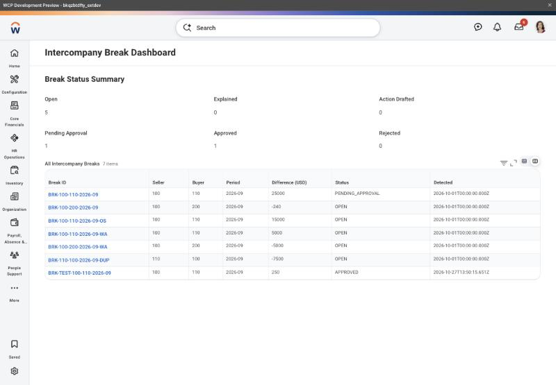
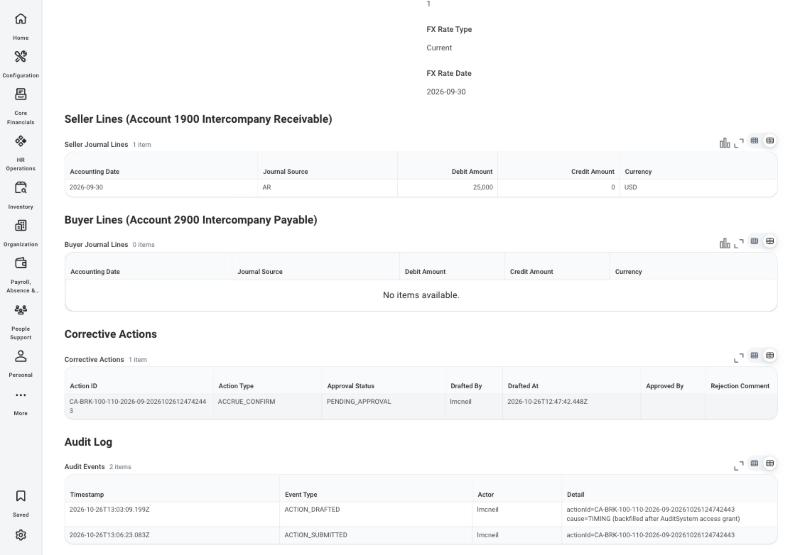
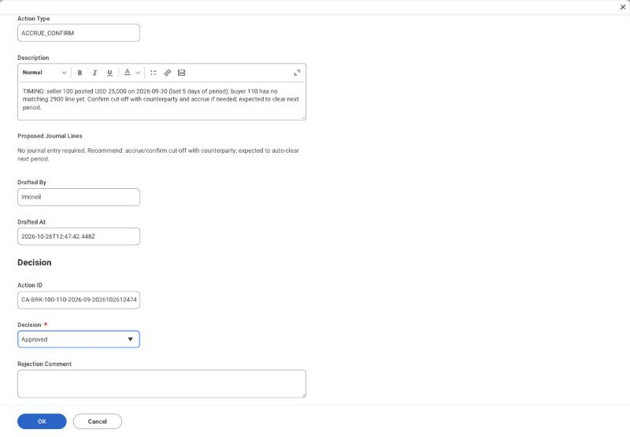
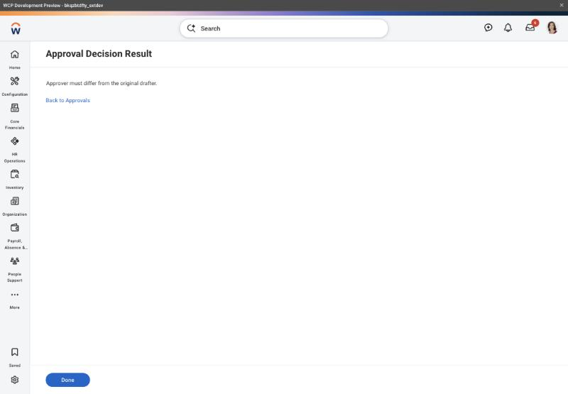
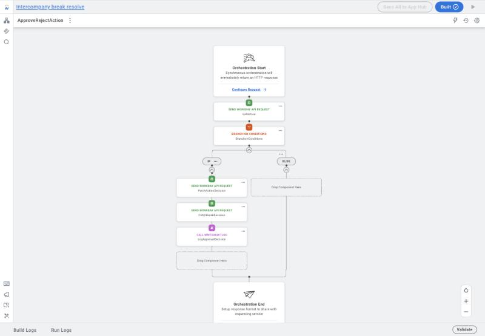

# IC Resolve – Intercompany Break Resolution on Workday Extend

A Workday Extend app that takes an intercompany balance break from detection to an approved, audited fix. I built it as a portfolio project and deployed and tested it end to end on a Workday Extend development tenant.

▶️ **[Watch the 1-minute launch video](docs/linkedin/IC_Resolve_launch.mp4)**

## Why

Intercompany receivables and payables rarely tie out on day one of month-end close. Teams chase differences in spreadsheets, explanations live in email, and it is hard to show who approved a fix. IC Resolve keeps that whole loop inside Workday, with controls built in.

## How it works

1. **Detect**: the `DetectBreaks` orchestration pulls intercompany journal lines through a RaaS report and compares 1900 (Intercompany Receivable) with 2900 (Intercompany Payable) for each company pair. On live tenant data the totals matched to the cent.
2. **Explain**: a Workday AI agent (`ic-explanation-agent`) classifies each break as timing, FX variance, one-sided, wrong affiliate or unknown, and cites its evidence.
3. **Draft**: the agent proposes a corrective action. A person confirms it before it is drafted and again before it is submitted.
4. **Approve**: a Close Manager approves or rejects it in `ApproveRejectAction`.
5. **Audit**: every step writes to an append-only `AuditLog` through the `WriteAuditLog` sub-orchestration, which fails the run unless the write succeeds.

## Controls

- The person who drafted an action can't approve it. The check runs in the orchestration (`context.subject()`), not just in the page.
- A rejection needs a comment.
- The approval writes nothing unless the submitted action ID matches the record it loaded (fail closed).
- The agent's tools are Draft and Submit only, so it can never approve.
- Four role-based security domains (Accountant, Close Manager, Auditor, Audit System) cover the pages, the business objects and the approval orchestration.

## Components

| Type | Items |
|---|---|
| Business objects | ICBreak, BreakExplanation, CorrectiveAction, AuditLog |
| Pages | Dashboard, Break Detail, Approvals, Approve/Reject, Approval Result |
| Orchestrations | DetectBreaks, DraftCorrectiveAction(+Agent), SubmitCorrectiveAction(+Agent), ApproveRejectAction, LogAuditEvent, WriteAuditLog |
| Agent | ic-explanation-agent with skills ic-break-classifier and ic-corrective-action |

The app source is in [`app/`](app/), exported from App Hub.

## Screenshots

| | |
|---|---|
|  |  |
|  |  |

## A bug worth sharing

My first "drafter blocked" test passed, but for the wrong reason. The App Logs showed the approval request was only 23 bytes: a hidden page field never sent the action ID, so the check ran against the wrong record. I moved the ID onto the endpoint itself (`values` on the outbound endpoint) and made the orchestration fail closed unless the record matches. The lesson: test what is actually sent, not just what is shown.

## Notes

- Built on a Personal Account development tenant with Workday demo data. It is not deployed to any production tenant.
- Test records in the screenshots are labelled TEST.
